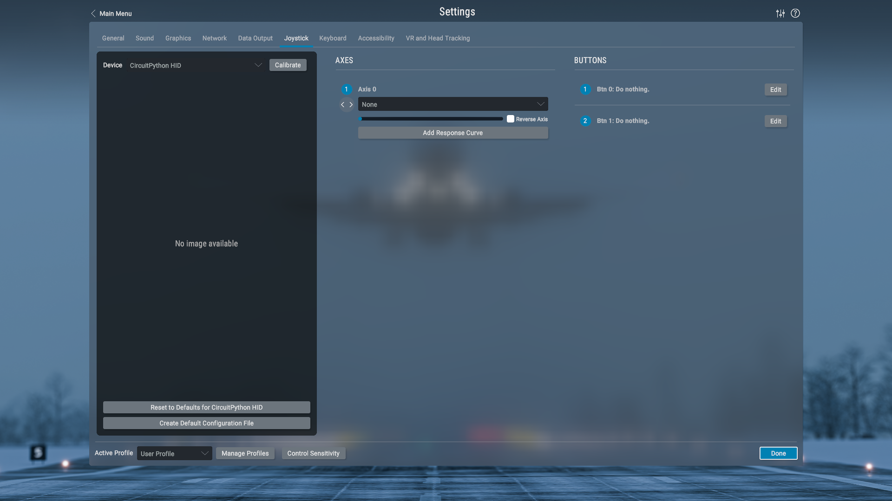

# ProximityTrinkey4XPlane

Use the Adafruit Proximity Trinkey as a USB joystick axis in X-Plane. Move your hand toward the sensor to move the axis. The two LEDs glow brighter red as your hand gets closer.

## What you need

- [Adafruit Proximity Trinkey](https://www.adafruit.com/product/5022)
- A USB data port
- X-Plane 11 or later

## Quick install

1. Back up everything on the **CIRCUITPY** drive to a folder on your computer.
2. Install CircuitPython on the Trinkey if it isn't already ([guide](https://learn.adafruit.com/adafruit-proximity-trinkey/circuitpython)).
3. Download the [Adafruit CircuitPython Library Bundle](https://circuitpython.org/libraries) (the **mpy** bundle matching your CircuitPython version, shown in `boot_out.txt` on **CIRCUITPY**). Unzip it, then copy these four items from its `lib` folder into a `lib` folder on **CIRCUITPY**:
   - `adafruit_apds9960` (folder)
   - `adafruit_bus_device` (folder)
   - `adafruit_pixelbuf.mpy`
   - `neopixel.mpy`
4. Copy `boot.py` and `code.py` from this project to the top level of **CIRCUITPY**.
5. Eject the drive, then unplug and reconnect the Trinkey.
6. In X-Plane, go to **Settings > Joystick**, select the device named **CircuitPython HID**, calibrate it, and assign **Axis 0** to a control.

Touch pads 1 and 2 appear as joystick `Btn 0` and `Btn 1`.
